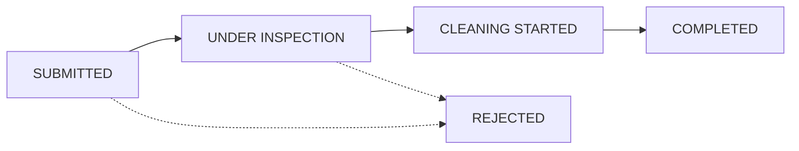

# Urban Flood Reporting & Smart Drain Monitoring System

> **Tagline:** Early Detection. Smart Analysis. Timely Action. Safer Cities.  
> **Academic Project:** IDEA LAB-II &bull; Computer Engineering  
> **Academic Theme:** Intelligent, Scalable and Inclusive Platforms for Digital Empowerment and Sustainable Futures  
> **Domain:** Urban System / Smart GovTech Infrastructure  

---

## 1. Problem Statement & Project Purpose

During the monsoon season, choked or overflowing roadside stormwater drains cause street waterlogging, vehicular disruption, damage to urban road foundations, and severe public safety hazards. 

- **Citizens** struggle with disconnected or unresponsive civic reporting channels and lack transparent visibility into whether actions are being taken.
- **Municipal Authorities** lack a centralized spatial view of active flood complaints, localized danger clusters, maintenance taskforce dispatches, and chronic recurring bottleneck points.

### The Solution:
A fully functional, real-time web application for citizen reporting and municipal maintenance operations, backed by an **Explainable AI-Assisted Risk Analysis Prototype**.
- Citizens report drainage issues with photos, GPS/manual location coordinates, and water-level severity.
- The system groups nearby reports, computes explainable risk scores (0–100), visualizes flood hazard zones on Leaflet maps, and alerts nearby users.
- Municipal engineers triage complaints, set priorities, assign specialized cleaning teams, track field work progress, and identify chronic drainage hotspots.

$$\text{Better Reporting} \longrightarrow \text{Faster Municipal Action} \longrightarrow \text{Better Drainage Maintenance} \longrightarrow \text{Safer and More Sustainable Cities}$$

---

## 2. Technology Stack

- **Frontend:** HTML5, CSS3, Bootstrap 5, Vanilla JavaScript (ES6+), Leaflet.js, OpenStreetMap, Leaflet.heat, Chart.js, Socket.IO client.
- **Backend:** Node.js (v20+), Express.js REST API, Socket.IO (live in-app alerts), Multer (file upload validation), BcryptJS (password hashing), JSON Web Tokens & HttpOnly Cookies.
- **Database & Persistence:** MongoDB & Mongoose ODM with dual-mode resilient local persistent storage fallback (`data/db.json`) for zero-dependency offline reliability.
- **Testing:** Automated system integration test suite verifying the complete 20-step municipal response lifecycle.

---

## 3. Project Directory Architecture

```
urban-drain-monitor/
├── client/                               # Frontend GovTech UI
│   ├── index.html                        # Public Landing Page & Workflow Overview
│   ├── login.html                        # Authentication with Demo Credential Autofill
│   ├── register.html                     # Citizen Registration Form
│   ├── citizen-dashboard.html            # Citizen Operations Portal
│   ├── report-problem.html               # Geo-tagged Complaint Submission Form
│   ├── my-reports.html                   # Citizen Complaint History
│   ├── report-details.html               # Complaint Details, Map, & 4-Stage Lifecycle Stepper
│   ├── risk-map.html                     # Interactive Leaflet Map & Heatmap
│   ├── hotspots.html                     # Chronic Recurring Hotspot Analytics
│   ├── admin-dashboard.html              # Municipal Command Console & Chart.js Charts
│   ├── manage-reports.html               # Admin Complaint Triage & Dispatch Table
│   ├── manage-teams.html                 # Maintenance Taskforce Management
│   ├── maintenance-dashboard.html        # Field Maintenance Worker Console
│   ├── notifications.html                # Persistent In-App Notifications & Alerts
│   ├── sustainability.html               # Sustainability & Civic Impact Dashboard
│   ├── about.html                        # Academic Theme & Solution Details
│   ├── prevention-insights.html          # Pre-Monsoon Civil Engineering Insights
│   └── assets/
│       ├── css/style.css                 # GovTech Design System Stylesheet
│       ├── js/api.js                     # API Wrapper & Realtime Socket Client
│       ├── js/auth.js                    # Session Guard & Navigation Builder
│       ├── js/maps.js                    # Leaflet Map Utilities & Popups
│       └── images/                       # SVG Logos & Photographic Evidence Assets
│
├── server/                               # Backend Application
│   ├── app.js                            # Express App & Route Mounting
│   ├── server.js                         # HTTP Server & Socket.IO Initialization
│   ├── config/
│   │   ├── database.js                   # MongoDB Connection with Fallback Manager
│   │   └── localDb.js                    # Persistent JSON Storage Adapter
│   ├── models/                           # Validated Data Models
│   │   ├── User.js                       # Citizen, Admin, & Maintenance Accounts
│   │   ├── Report.js                     # Complaints, Coordinates, & Audit History
│   │   ├── Team.js                       # Maintenance Cleaning Taskforces
│   │   ├── Task.js                       # Work Order Assignments & Completion
│   │   ├── Notification.js               # Persistent In-App Notifications
│   │   ├── RiskArea.js                   # AI-Assisted Spatial Clusters
│   │   ├── Hotspot.js                    # Recurring Problem Locations
│   │   └── modelFactory.js               # Dual-Mode ODM Proxy Factory
│   ├── routes/                           # REST API Routes
│   ├── controllers/                      # Request Handlers & Business Logic
│   ├── middleware/                       # JWT Auth, Role Guards, Multer Upload, Errors
│   ├── services/                         # Core Algorithmic Engines
│   │   ├── riskAnalysis.service.js       # AI-Assisted Rule-Based Risk Engine
│   │   ├── hotspot.service.js            # Recurring Hotspot Detection Algorithm
│   │   ├── priority.service.js           # Complaint Priority Classification
│   │   └── notification.service.js       # Persistent Alerts & Nearby Notification
│   ├── utils/
│   │   ├── reportIdGenerator.js          # Sequential UD-YYYY-XXXX Generator
│   │   └── geoUtils.js                   # Haversine Distance & Centroid Math
│   └── tests/
│       └── system.test.js                # End-to-End Automated Test Suite
│
├── uploads/                              # Persistent Complaint Photo Uploads
├── scripts/
│   └── seedDemoData.js                   # Demonstration Dataset Seeder
├── data/                                 # Persistent Database Storage
├── .env.example                          # Environment Configuration Template
├── package.json                          # Dependencies & NPM Scripts
└── README.md                             # Comprehensive Documentation
```

---

## 4. Quick Start & Setup Instructions

### Prerequisites
- Node.js (v18 or higher recommended; developed on Node v20.11.1)
- NPM (v9+)
- *(Optional)* Local MongoDB service or MongoDB Atlas URI. If MongoDB is not running locally, the system automatically falls back to the embedded JSON-persistent engine (`data/db.json`) so the entire application runs out of the box!

### 1. Installation
Navigate to the project directory:
```bash
cd "C:\Users\NEERAJ PRAJAPATI\.gemini\antigravity-ide\scratch\urban-drain-monitor"
npm install
```

### 2. Environment Configuration
Create a `.env` file from `.env.example`:
```bash
cp .env.example .env
```
Default configuration values:
```env
PORT=3000
NODE_ENV=development
MONGODB_URI=mongodb://127.0.0.1:27017/urban_drain_monitor
JWT_SECRET=super_secret_jwt_key_urban_drain_2026_academic_lab
JWT_EXPIRES_IN=7d
UPLOAD_DIR=uploads
MAX_FILE_SIZE_MB=5
GEO_CLUSTER_RADIUS_METERS=800
RISK_TIME_WINDOW_HOURS=72
DUPLICATE_DISTANCE_METERS=100
DUPLICATE_TIME_WINDOW_HOURS=24
```

### 3. Seed Demonstration Data
Populate the database with realistic demonstration reports across Virar West, Nalasopara East, and Vasai East:
```bash
npm run seed
```

### 4. Run Automated System Tests
Execute the automated test suite verifying all 20 workflow requirements:
```bash
npm test
```

### 5. Launch Application
Start the server:
```bash
npm start
```
Open your web browser and navigate to:
```
http://localhost:3000
```

---

## 5. Demonstration Mode & Pre-Configured Test Accounts

All demonstration data is visibly tagged with a `DEMO DATA` badge to maintain academic integrity and distinguish simulated reports from live municipal records.

| Portal Role | Email Address | Password | Permissions & Dashboard |
| :--- | :--- | :--- | :--- |
| **Citizen Portal** | `citizen@example.com` | `Citizen@123` | Submit reports, upload photos, GPS location, view personal timeline, receive flood alerts |
| **Municipal Admin** | `admin@citydrain.gov.in` | `Admin@123` | Full triage table, verify complaints, override priority, dispatch teams, Chart.js analytics |
| **Maintenance Unit** | `team@draincare.org` | `Team@123` | Field console, accept tasks, mark cleaning started, upload completion proof, finalize work |

> **Tip:** The login page (`http://localhost:3000/login.html`) includes 1-click **Autofill Buttons** for fast evaluation.

---

## 6. AI-Assisted Risk Engine & Priority Formulation

### Technical Honesty:
As documented in the project proposal, this initial implementation is an **AI-Assisted Risk Analysis Prototype — Rule-Based Engine**. It utilizes deterministic, explainable mathematical modeling rather than black-box machine learning.

### Risk Score Calculation ($0 \text{ to } 100$ Points):
Every complaint and geographic cluster is evaluated across four normalized dimensions:

1. **Water Level Severity (Up to 35 pts):**
   - $\text{High} \longrightarrow +35\text{ pts}$ (Imminent threat of roadway inundation)
   - $\text{Medium} \longrightarrow +20\text{ pts}$ (Moderate drainage restriction)
   - $\text{Low} \longrightarrow +8\text{ pts}$ (Normal flow hindrance)
2. **Problem Category Severity (Up to 25 pts):**
   - $\text{Drain Overflow} \longrightarrow +25\text{ pts}$ (Acute public health & flooding hazard)
   - $\text{Waterlogging} \longrightarrow +22\text{ pts}$ (Obstruction of vehicular/pedestrian flow)
   - $\text{Drainage Damage} \longrightarrow +18\text{ pts}$ (Structural compromise requiring civil repair)
   - $\text{Blocked Drain} \longrightarrow +15\text{ pts}$ (Silt & plastic accumulation)
   - $\text{Other} \longrightarrow +10\text{ pts}$
3. **Spatial Proximity Clustering (Up to 30 pts):**
   - Haversine distance calculated against all active reports within a configurable $800\text{m}$ radius over the past $72\text{ hours}$.
   - $\ge 5\text{ reports} \longrightarrow +30\text{ pts}$ (High-density flood cluster)
   - $2\text{ to }4\text{ reports} \longrightarrow +20\text{ pts}$ (Moderate cluster)
   - $1\text{ report} \longrightarrow +10\text{ pts}$ (Corroborating nearby incident)
4. **Unresolved Complaints Ratio (Up to 10 pts):**
   - $\ge 2\text{ unresolved reports in cluster} \longrightarrow +10\text{ pts}$

$$\text{Final Risk Score} = \min(100, \max(5, \sum \text{Factors}))$$

$$\text{Classification: } 0\text{–}30 \implies \text{LOW RISK} \quad|\quad 31\text{–}60 \implies \text{MEDIUM RISK} \quad|\quad 61\text{–}100 \implies \text{HIGH RISK}$$

---

## 7. Complaint Lifecycle & State Machine

The complaint progression strictly preserves the proposed academic proposal lifecycle:



1. **SUBMITTED:** The citizen files a geo-tagged report with photos, water level, and description. An explainable risk score is calculated and unique ID (`UD-2026-XXXX`) assigned.
2. **UNDER INSPECTION:** Municipal administrator reviews evidence, checks proximity duplicates, verifies validity, and adjusts priority if necessary.
3. **CLEANING STARTED:** Administrator assigns a specialized maintenance taskforce. Field team arrives on site and logs start of work with equipment notes.
4. **COMPLETED:** Maintenance team clears obstructions, restores flow, uploads resolution proof, and marks work finalized. The citizen receives an automatic resolution notification and updated progress timeline.

---

## 8. REST API Reference

| Endpoint | Method | Role | Description |
| :--- | :---: | :---: | :--- |
| `/api/auth/register` | `POST` | Public | Register a new citizen account |
| `/api/auth/login` | `POST` | Public | Authenticate user & issue JWT cookie/token |
| `/api/auth/me` | `GET` | Authenticated | Retrieve current session profile |
| `/api/reports` | `GET` | Public/Auth | Query reports with search, status, and risk filters |
| `/api/reports` | `POST` | Citizen | Submit a new complaint with photo upload |
| `/api/reports/my-reports`| `GET` | Citizen | Retrieve complaints filed by authenticated citizen |
| `/api/reports/:id` | `GET` | Public/Auth | Retrieve single report with audit timeline & evidence |
| `/api/reports/check-duplicate`| `GET`| Public | Helper checking for unresolved reports within 100m |
| `/api/admin/overview` | `GET` | Admin | Aggregate counts for municipal command console |
| `/api/admin/reports/:id/verify`| `PUT` | Admin | Verify or dismiss complaint with inspection notes |
| `/api/admin/reports/:id/priority`| `PUT`| Admin | Override priority with required recorded reason |
| `/api/admin/reports/:id/assign` | `PUT` | Admin | Dispatch maintenance team and create task |
| `/api/admin/reports/:id/status` | `PUT` | Admin | Update complaint lifecycle status |
| `/api/admin/reports/:id/duplicate`| `PUT`| Admin | Flag report as duplicate of existing ID |
| `/api/teams` | `GET` | Public/Auth | List registered maintenance units |
| `/api/teams` | `POST` | Admin | Register new maintenance squad |
| `/api/tasks` | `GET` | Auth | List field maintenance work orders |
| `/api/tasks/:id/status` | `PUT` | Maintenance/Admin| Update task progress, start cleaning, or complete |
| `/api/risk/areas` | `GET` | Public | Retrieve active spatial risk cluster zones |
| `/api/risk/recalculate` | `POST` | Admin | Trigger full spatial risk recalculation |
| `/api/hotspots` | `GET` | Public | Retrieve chronic recurring drainage bottleneck sites |
| `/api/map/reports` | `GET` | Public | Map markers with sanitized public attributes |
| `/api/map/heatmap` | `GET` | Public | Normalized `[lat, lon, intensity]` coordinates |
| `/api/analytics/dashboard`| `GET` | Public/Admin | Chart.js payloads for status, risk, and type charts |
| `/api/analytics/sustainability`| `GET`| Public | Empirical and prototype sustainability metrics |
| `/api/analytics/prevention`| `GET` | Public | Strategic pre-monsoon civil engineering findings |
| `/api/notifications` | `GET` | Authenticated | Persistent in-app notifications and alerts |
| `/api/notifications/:id/read`| `PUT`| Authenticated | Mark alert as read |

---

## 9. Current Scope vs. Future Scope

### Implemented in Current Application:
- [x] Citizen reporting with photo upload, GPS, and manual map click coordinate selector.
- [x] Water-level severity (Low, Medium, High).
- [x] Unique report ID generator (`UD-YYYY-XXXX`).
- [x] 4-stage complaint lifecycle tracking with interactive stepper timeline.
- [x] AI-Assisted explainable rule-based risk analysis engine.
- [x] Interactive Leaflet & OpenStreetMap interface with marker clusters and flood heatmap.
- [x] Municipal Admin Operations Dashboard with real Chart.js charts.
- [x] Priority triage and administrative override with recorded reasons.
- [x] Maintenance team dispatch and field console with completion evidence.
- [x] Proximity-based recurring hotspot detection engine.
- [x] Persistent in-app notification system with Socket.IO realtime broadcasts.
- [x] Sustainability metrics and pre-monsoon prevention insights dashboard.
- [x] Dual-mode database persistence with automated seed script and 100% test suite.

### Kept as Future Enhancements:
- Physical IoT ultrasound drain depth sensors.
- Supervised machine learning models trained on decades of local meteorological precipitation data.
- SMS/WhatsApp gateway integration with official government telecom APIs.
- Official civil disaster management integration (NDRF / Disaster Management Cell).

---

## 10. License & Academic Attribution
Developed for the **IDEA LAB-II Computer Engineering Project**.  
All demonstration records represent simulated scenarios designed to evaluate the software architecture and response pipeline.
